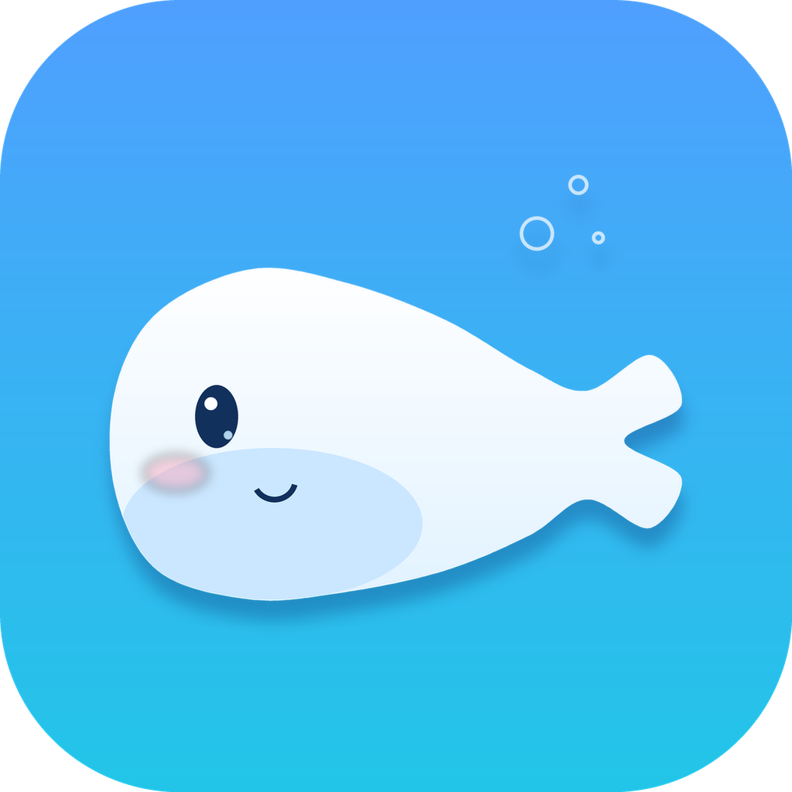

# 小鲸鱼桌宠（Whale Pet）v0.2

<p align="center"></p>

一只**独立运行在 Windows 桌面上**的小鲸鱼：不需要打开 DeepSeek Harness 窗口，也能一直在屏幕角落陪着你。
它现在是「工作助手 + 情感陪伴」的本地版本：

- 🧠 **有记忆**：事实、待办、提醒、每日摘要、逐轮对话都落在本地，关机重开还在
- 🛠️ **能干活**：聊天里说「记一下…」「提醒我…」会真的写进待办/提醒（工具调用，不是嘴上答应）
- 🌱 **会进化**：每 4 轮自动抽取记忆，每天自动整理一次，把人设补充写进 `persona.md`
- 👀 **可审查**：右键「记忆与设定」能看到、删除、手动修改它记住的一切

技术栈：Windows PowerShell 5.1 + WPF，**零第三方依赖**（不需要 Node / Electron / Python / 数据库服务）。

---

## 一、启动

- 双击桌面 **「小鲸鱼桌宠」**；或
- 双击 `start-whale-pet.vbs`（无控制台窗口）

开机自启已加到「启动」文件夹，登录 Windows 后自动出现。
右键菜单里还有「重启桌宠」，改完代码/更新后不用手动找进程。

> 如果 360 弹「有程序修改系统启动目录」，点**允许**即可；不允许也不影响手动启动。

## 二、第一次聊天

1. 打开 <https://platform.deepseek.com/api_keys> 创建 API key（`sk-` 开头）
2. **右键小鲸鱼 →「设置…」** → 粘贴 → 保存

余额会显示在聊天窗口标题栏，按 token 计费，和 DeepSeek 账号同一个钱包。

## 三、它能记住什么

| 类型 | 来源 | 例子 |
|---|---|---|
| 事实 `facts` | 你说「记住…」/ 自动抽取 / 每日整理 | 「喜欢先看结论」「在做 V2 接口」 |
| 待办 `todos` | 说「记一下…」或记忆面板手动加 | 「交周报（截止明天 15:00）」 |
| 提醒 `reminders` | 说「N 分钟后提醒我…」 | 到点冒泡 + 托盘气泡 |
| 摘要 `summaries` | 每日整理 | 「今天主要在改文档，晚上效率高」 |
| 人设 `persona.md` | 默认人设 + 「我学到的」 | 「- 喜欢晚上写代码」 |
| 对话 `sessions/*.jsonl` | 每一轮 | 重启后作为上下文 |

**自我进化怎么发生：**

- 每 4 轮对话：后台调用一次「记忆抽取」，把稳定信息写进 facts/todos（不打扰你）
- 每天第一次启动：对**昨天**的对话做一次「每日整理」，生成摘要 + 最多 3 条稳定特征，追加到 `persona.md` 的「我学到的」
- 所有自动写入都可以在「记忆与设定」里删除或改写；人设也能直接编辑保存

> 隐私：除了聊天/抽取/整理要发到 DeepSeek API，**其余全部在本机**；API Key 用 Windows DPAPI 加密存储。

## 四、操作

| 操作 | 效果 |
|---|---|
| 拖动 | 移动位置，记住 |
| 单击 | 冒泡：随机台词 + 余额/今日 token/待办数 |
| 双击 | 打开聊天 |
| 右键 | 聊天 / 记忆与设定 / 我的待办 / 整理今天的记忆 / 刷新余额 / 置顶 / 开机自启 / 设置 / 换皮肤 / 重启 / 退出 |
| 聊天窗口「记忆」按钮 | 直接打开记忆面板 |
| 托盘图标 | 双击聊天，右键显示隐藏/记忆/退出 |

聊天里可以直接说：

- 「记一下：周五之前把报价单发给老王」
- 「20 分钟后提醒我开会」
- 「我今天要做什么？」
- 「你还记得我在做什么项目吗？」

**错过的提醒**：如果关机/不在时有过期的提醒，下次启动会弹出「错过的提醒」窗口，列出每一条和错过时长，让你选 **补发 / 忽略 / 稍后再说**（稍后再说 = 本次不再打扰，下次启动再问）。

**余额不足**：余额低于阈值（默认 ¥5，`config.json` 里 `lowBalanceThreshold` 可改）时，桌宠会主动冒泡 + 托盘通知；聊天真的遇到 402 时也会在桌面提醒，而不是只在聊天框里留一行错误。

**充值恢复**：余额回到阈值以上时，会冒泡「余额回来啦～ 现在 ¥xx，可以继续聊了」并弹通知；这个“曾经不足”的状态会记在 `config.json`（`lastBalanceLow`），所以关掉桌宠再充值，下次启动也会告诉你。

### 读屏（看看这个）

右键 →「看看这个（读屏）」：

- 抓当前前台窗口，用 **Windows 自带 OCR**（本地、不联网）识别文字
- 结果会冒泡提示，并作为下一条消息的上下文交给模型
- 中文 OCR 的逐字空格会自动去掉；原图只临时存在 `data/tmp`，用完即删

### 语音朗读

右键 →「朗读回复」（可勾选）：

- 用 Windows SAPI 朗读小鲸鱼的回复，默认中文语音（如 Microsoft Huihui）
- 只读前 300 字，新回复会打断旧的朗读
- 默认关闭，第一次开启会读一句试听

### 交给 DSH（工作类任务）

**直接在聊天里说就行**，两种触发方式：

- **自动识别**：说「在工作区建一个 note.txt」「跑一下测试」「帮我查一下这个仓库的结构」，模型判断需要动手，会自动调用 DSH
- **显式唤起**：消息以 `@dsh`、`dsh:`、「交给 DSH」「让 DSH」开头，直接走 DSH，不经过闲聊模型

调用后它会先说「已经交给 DSH 了，完成后告诉你」，几秒后结果自动出现在聊天里（可朗读）。菜单里保留了一个「交给 DSH（备用）」，模型判断失误时手动兜底。

DSH 侧使用本机 `headless` 的 **持久会话 + JSON 事件流**：

- 第一次任务会创建会话，会话 id 存在 `data/dsh-session.json`，之后一直沿用（重启桌宠也记得）
- 输出按 `--json` 事件流实时更新气泡，不用等整段跑完
- 想换话题：右键 →「开始新的 DSH 会话」

**模糊请求会先确认**：像「把 xxx 改成…，可以吗？」这种既像请求又像询问的，桌宠会先问「要我交给 DSH 去做吗？」，回「要」才执行，回「不要」就不动。


- 用你已配置的 DeepSeek API Key（只注入给该子进程，不写进命令历史）
- 工作目录是 `data/workspace`
- 结果回显在聊天窗口，可朗读
- 第一次会创建 `~/.dsh/profiles/headless`，可能慢；单次一般几秒到几十秒

分工原则：**闲聊、关心、记忆 → 小鲸鱼自己；干活 → DSH**。
### 工作区与读文件

- 右键 →「打开工作区」，对应 `data/workspace`
- 聊天里可以让它「读一下工作区里的 xxx.txt」「列一下工作区有哪些文件」
- 工具只允许访问工作区内的文件，读文本最多 8000 字，二进制会拒绝
### 换皮肤

右键 →「换皮肤…」打开皮肤面板：

- **导入图片**：支持 PNG / GIF / JPG，建议透明背景、正方形；GIF 会逐帧播放
- 导入后即时生效，重启也记得（存在 `data/skins.json`）
- **恢复默认** 一键切回；非默认皮肤可以 **删除**
- 皮肤文件在 `data/skins/`，删掉整个目录或 `skins.json` 也会自动回到默认，不会影响记忆

## 五、文件说明

```
whale-pet/
├─ WhalePet.ps1           主程序（WPF 界面 + 聊天 + 工具循环）
├─ start-whale-pet.vbs    静默启动器
├─ lib/
│  ├─ Store.psm1          记忆层（事实/待办/提醒/摘要/对话/人设）
│  ├─ Brain.psm1          提示词、工具定义、抽取/反思模板
│  └─ Skins.psm1          皮肤管理（导入/切换/删除）
├─ assets/                形象与图标
└─ data/                  运行数据（不进 git）
   ├─ config.json         位置/模型/加密后的 API Key/余额阈值
   ├─ memory.json         事实、待办、提醒、摘要
   ├─ persona.md          人设（可编辑，自我进化写这里）
   ├─ skins/              导入的皮肤图片
   ├─ skins.json          皮肤清单 + 当前皮肤
   ├─ sessions/*.jsonl    逐轮对话
   └─ whale-pet.log       运行日志
```

## 六、卸载 / 重置

- 退出：右键 → 退出（或托盘右键）
- 只清记忆：删除 `data/memory.json`、`data/sessions/`（保留 `config.json` 就不用重填 Key）
- 完全卸载：退出 → 删除启动文件夹快捷方式（`shell:startup`）和桌面快捷方式 → 删除整个目录

## 七、常见问题

- **聊天报 401**：Key 错了，重新填。
- **聊天报 402 / 桌面冒「余额不足」**：去 platform.deepseek.com 充值；充完点「刷新余额」或等 90 秒自动刷新。
- **到点没提醒**：确认桌宠在运行；关机期间错过的提醒会在下次启动的「错过的提醒」窗口里让你决定是否补发。
- **记忆没更新**：自动抽取每 4 轮触发一次；也可以点「整理记忆」手动跑。
- **想换形象**：替换 `assets/whale.png`（610×610 透明 PNG），重启。
- **想改语气**：直接编辑 `data/persona.md`，或在记忆面板里改完保存。

## 八、许可与素材来源

- **代码**：MIT（见 `LICENSE`）。
- **形象与图标**：原创绘制，由 [`tools/make-art.py`](tools/make-art.py) 生成（Pillow，4× 超采样 + Catmull-Rom 平滑轮廓），随项目以 MIT 授权，不再依赖任何第三方角色素材。
- **想改形象**：直接替换 `assets/whale.png`（1024×1024 透明 PNG），或改脚本里的颜色/轮廓参数后重新运行：
  `python tools/make-art.py`（同时生成 `assets/icon.png` 和 `assets/whale.ico`）。

## 九、和 DSH 插件的关系

- 这是**独立桌宠**，DSH 关掉也照样运行。
- DSH 里那个「小鲸鱼挂件」只出现在 DSH 窗口右下角，两者互不影响，可同时使用。
- 以后接云端/微信时，`data/` 里的记忆结构可以直接迁移到服务端，不用重做。
